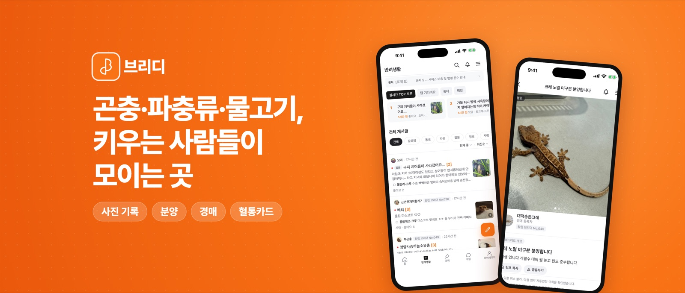
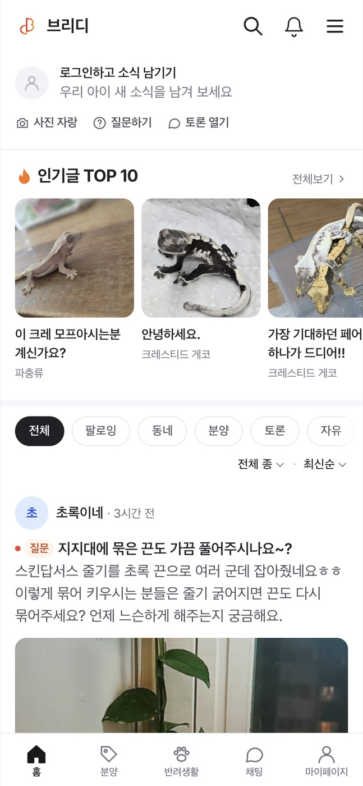
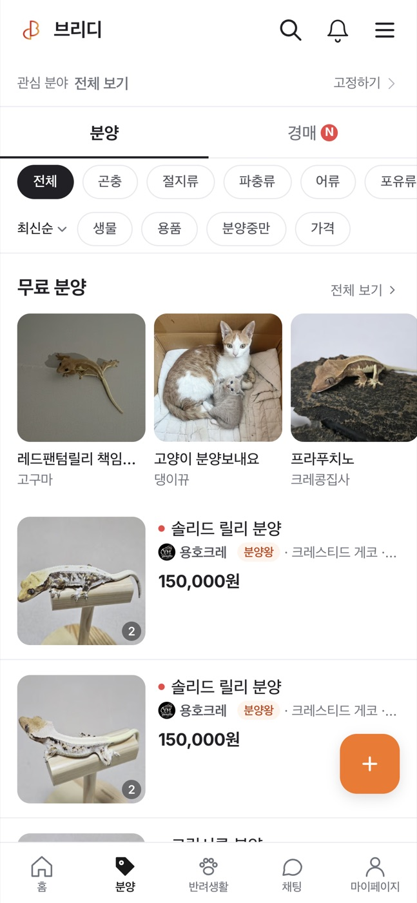
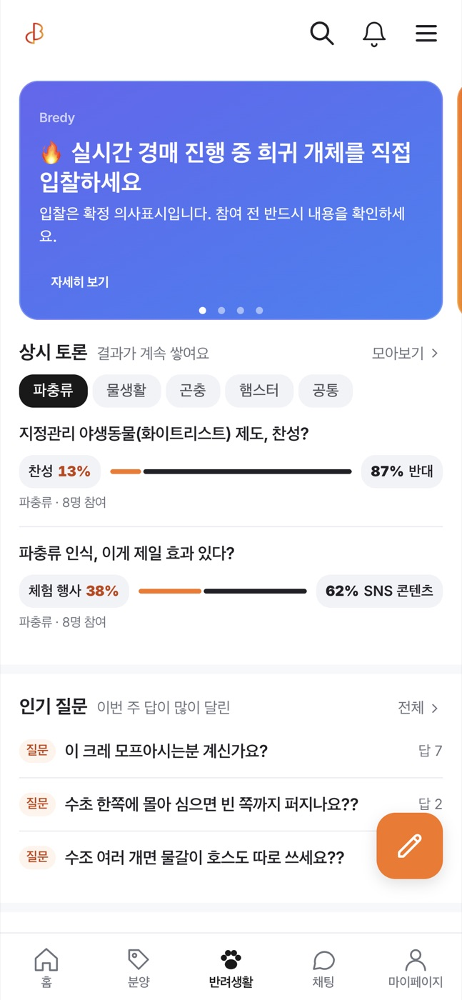
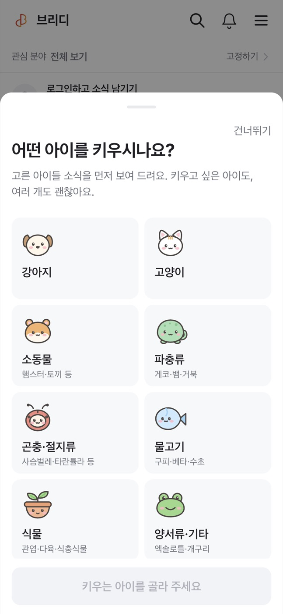
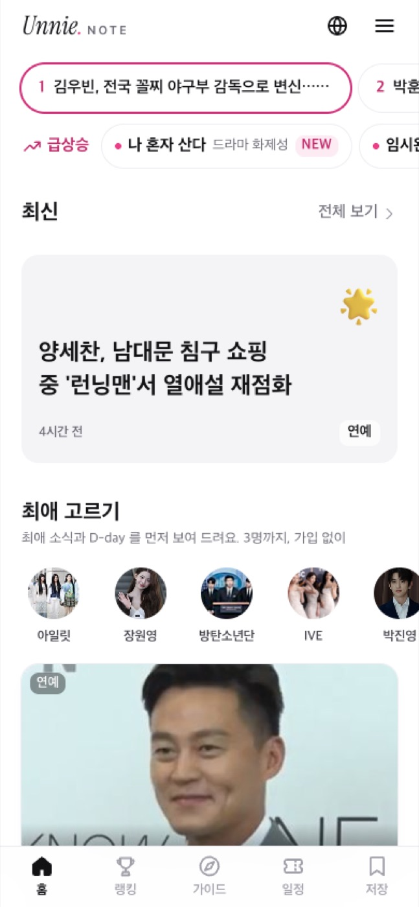
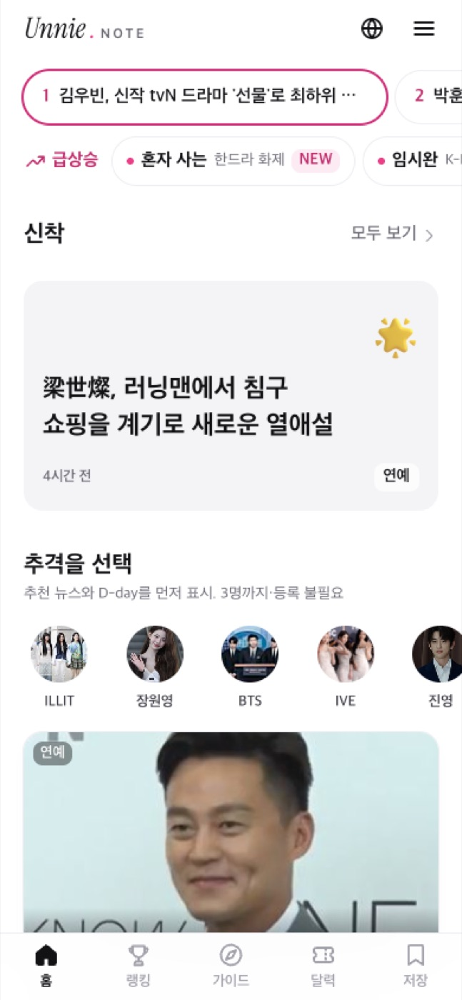
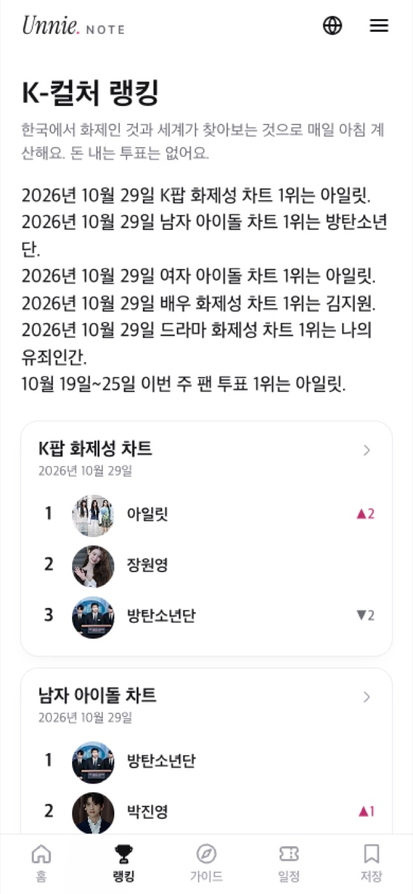

# 윤성준

원래는 프론트엔드 개발자인데(5년차), 요즘은 그냥 프로덕트 개발자라고 소개하는 편입니다.
회사(BHSN)에서는 계약 관리 서비스 앨리비랑 AI 에이전트 쪽 화면 만들고 있고요. 25년 7월부터 머지한 PR이 352건 정도 됩니다.

퇴근하고는 브리디(생물 커뮤니티)랑 언니노트(K-컬처 미디어)를 혼자 굴리고 있습니다. 제 서비스라 서버, DB도 그냥 제가 합니다.
- 브리디: 10월 20일에 앱스토어, 플레이스토어 둘 다 나왔습니다. 그 전에 창립 브리더 100자리 열었는데 출시 나흘 전에 다 찼고요.
  웹은 10월 6일 v1.0.0 붙이고 20일 동안 운영 배포 74번 했습니다. 하루 방문자는 11명에서 닷새 만에 115명까지 갔고, 출시 주(10/20~26)는 방문 636명, 가입 121명이었습니다. 전주보다 가입이 두 배쯤.
- 언니노트: 9개 언어로 나가고, 많은 날은 하루 기사 120개 넘게 올라갑니다. 기사 하나 AI 비용이 4원 정도.

일하는 건 대충 이렇습니다. PostHog 숫자 보다가 이상하거나, 사용자가 뭐 안 된다고 하면 그거 들고 에이전트랑 같이 고칩니다.

뭘 만들기 전에 이게 진짜 본질인지, 핵심인지부터 생각하는 편입니다.
결국 돈이 될지를 많이 봅니다. 돈이 된다는 게 저한테는 사용자가 좋아할지, 그리고 길게 봤을 때 회사에 유리한지입니다.
같은 일은 두 번 하기 전에 자동화하거나 더 효율적으로 할 방법부터 생각합니다. 일이라서 그런 건 아니고, 원래 그렇게 생겨 먹었습니다.

📄 [포트폴리오 PDF 보기](pdf-portfolio/%EC%9C%A4%EC%84%B1%EC%A4%80_%ED%8F%AC%ED%8A%B8%ED%8F%B4%EB%A6%AC%EC%98%A4.pdf) · [다운로드](https://github.com/ytw418/about-me/raw/main/pdf-portfolio/%EC%9C%A4%EC%84%B1%EC%A4%80_%ED%8F%AC%ED%8A%B8%ED%8F%B4%EB%A6%AC%EC%98%A4.pdf)

ytw418@naver.com · [원티드 이력서](https://social.wanted.co.kr//community/profile/8xuyY3Btrdg33yd7Fbbfkt?utm_source=wanted&utm_medium=share)

## 문제를 찾는 방법

고치기 전에 이게 진짜 문제인지부터 봅니다. 숫자 자체가 틀려 있던 적도 있었어서요(분양글 상세 이벤트는 21세션인데 페이지뷰는 3세션).
보는 건 PostHog 숫자, 사용자 제보, 기획서랑 예전에 정해 둔 것들 정도입니다.
코드는 그 다음에 엽니다.

- **숫자로: 브리디 홈을 다시 짠 이유**
  "내가 봐도 별로 안 쓰고 싶다"는 느낌을 먼저 PostHog로 쟀습니다(새 홈 6일).
  홈에 온 사람 중 글을 연 사람이 약 28%, 좋아요·댓글·투표를 한 사람은 약 8%, 7일 안에 다시 온 사람은 19%였습니다.
  섹션 9개를 보니 첫 화면은 이미 활동하는 사람용 순위·소개로 차 있고 동물 사진은 맨 아래에 있었습니다.
  그래서 인기글과 사진 피드를 위로 올리고 분양·경매를 한 탭으로 합쳤습니다. 출시 전에 성공 기준(28→40%, 8→15%, 19→25%)과 "분양·경매 상세는 10% 넘게 줄지 않는다"는 가드레일부터 정했습니다.
- **숫자로: 숫자부터 믿을 수 있게**
  분석하다 보니 분양글 상세 이벤트는 21세션인데 페이지뷰는 3세션이었습니다. 지표 자체가 틀린 것이었습니다.
  페이지뷰 누락, 사용자 식별 0건, 비로그인 401 소음, 섹션 노출이 한꺼번에 찍히는 문제까지 4개를 고쳤고, 배포 시각을 기준으로 앞뒤 데이터를 나눠 봅니다.
- **제보로: "혈통 등록이 안 돼요"**
  운영 로그는 1시간만 남는 플랜이라 지난 제보는 로그로 볼 수 없었습니다.
  대신 PostHog 클릭 기록을 사람별 시간순으로 이어 보니 "두 번 눌러도 안 되다가 이름을 고친 뒤 성공"하는 흐름이 보였습니다.
  폰 높이로 재현해 보니 오류 문구가 하단 고정 버튼 때문에 화면 밖에 떠 있었습니다. 고장이 아니라 안내가 안 보이던 것이었고, 그날 고쳐서 배포했습니다.
- **기획서로: 버그 신고가 사실은 정책 공백이었던 일 (BHSN)**
  "AI 캔버스에서 저장할 때마다 계약서가 새로 생긴다"는 이야기가 버그로 올라왔습니다.
  코드를 보기 전에 슬랙 결정 기록, 티켓, 요금 정책, 피그마를 거슬러 올라갔습니다. 저장할 때마다 새로 만드는 건 원래 기획 의도였습니다. 다만 기획이 "한 번 저장하고 끝"을 전제해서 수정 후 다시 저장할 때의 규칙이 비어 있었습니다.
  같은 계약서에 새 버전을 붙이는 API가 이미 있다는 것과 저장 계측이 없다는 것까지 정리해서, 버그 수정이 아니라 정책을 정할 질문으로 넘겼습니다.
- **계측 공백으로: 광고 성과가 안 보이던 이유 (BHSN)**
  그로스팀 요청을 처리하다가, 가입 API로 유입값이 한 번도 넘어가지 않고 있었다는 걸 찾았습니다. 앨리비에서 Cue로 넘어가는 가입은 도메인이 달라서 첫 유입 기록도 사라지고 있었습니다.
  메타 픽셀과 가입 전환을 붙이고, 유입값을 주소에 실어 Cue까지 이어 가게 했습니다.

## 혼자서 팀처럼 일하는 방법

반복되는 일은 에이전트에게 맡겼습니다. 지금은 매일 19개 일정이 알아서 돌아갑니다.

- 인스타그램, 스레드, 페이스북, 틱톡, 유튜브, X 게시 자동화
- 웹 CI/CD, 앱 코드푸시, 앱스토어·플레이스토어 제출까지 명령 하나로 처리
- 마케팅 지표 브리핑이 매일 아침 슬랙으로 옵니다. 에이전트가 PostHog에서 어제와 지난 7일을 비교해 유입 채널, 이탈, 퍼널이 끊기는 곳, 오늘 할 일 두세 개를 정리합니다. 그걸 보고 고치고, 다음 날 브리핑에서 다시 확인합니다
- SEO와 AEO(AI 검색 노출)까지 직접 작업
- 그 결과 웹 하루 방문자가 11명(10월 6일)에서 닷새 만에 115명(10월 11일)이 됐습니다
- 9월 30일부터 2주 동안 웹 커밋 300개, 앱 커밋 230개를 넘겼습니다. 거의 다 에이전트와 같이 한 것입니다

만든 스킬은 [ytw418-agent-skills](https://github.com/ytw418/ytw418-agent-skills)에 모아 두었습니다.

## 회사에서 · BHSN (2025.06 ~)

계약서 검토·작성·전자서명·이행관리 SaaS인 앨리비, AI 계약 앱 Cue, AI 법률 에이전트의 프론트엔드를 만듭니다.
SvelteKit과 TypeScript로 된 Turborepo 모노레포이고, 에이전트 화면은 React로 만들어 Svelte로 된 Cue 안에 마이크로 프론트엔드로 띄웁니다.

2025년 7월부터 머지한 PR이 352건입니다. 가장 바빴던 7~9월 석 달에 162건이 몰려 있습니다.

### 회사 사정으로 일하는 방식이 바뀌고 나서

회사 사정으로 기획이 내려오길 기다릴 수 없는 상황이 됐습니다. 그때부터는 문제를 직접 찾아서 기획, 디자인, 개발까지 하고 있습니다.

먼저 회사 정보부터 모았습니다. 노션, 지라, 컨플루언스, PostHog, 코드베이스에 흩어져 있던 걸 긁어서 요약해 두고, 제 컴퓨터에 '시냅스'라는 폴더로 정리했습니다.
그걸 들고 클로드랑 가입이랑 매출을 어디서 늘릴 수 있을지 찾고, PRD를 씁니다.
그다음엔 API랑 응답을 임시로 바꿔서 화면을 먼저 만들고, 녹화해서 지라에 올려 팀에 공유합니다. 합의되면 백엔드가 임시 API를 진짜 API로 만들고, QA 거쳐서 배포합니다.
배포하고 나면 PostHog로 숫자 보면서 다시 고칩니다. 이걸 계속 반복하고 있습니다.

- **매출 지표 브리핑**: 매출이 제일 급했는데, 누가 언제 몇 명 들어오고 어디서 나가는지, 결제를 왜 안 하는지 제대로 아는 사람이 없었습니다. PostHog 데이터를 클로드한테 보여 주고 어디가 문제고 뭘 고치면 될지 가설까지 세우게 해서, 매일 아침 회사 공통 채널에 올렸습니다
- **광고 성과 추적**: 키워드 광고에 매달 큰돈을 쓰는데 그게 가입으로 이어지는지 아무도 몰랐습니다. 확인해 보니 가입 API에 유입값이 아예 안 넘어가고 있었습니다. UTM이랑 GTM 붙이고 광고 유입부터 회원가입 완료까지 이어지게 연결해서, 마케팅 채널에 따로 브리핑하게 했습니다
- **팀 데일리 브리핑**: 매일 아침 클로드 루틴이 지라, 컨플루언스, 슬랙을 뒤져서 팀원별로 지금 뭐 하는지, 어디서 막혔는지 정리해 올립니다
- **마케터분이랑**: 회사에 마케팅 전문 인력이 없었는데, 새로 오신 마케터분이 AI도 잘 쓰시고 의욕도 넘쳐 보여서 먼저 말을 걸었습니다. "저도 요즘 마케팅에 관심 많은데, 예전에 마케팅 회사도 다녔었어요. 주로 어떤 마케팅 하세요?" 엄청 반가워하셨고, 제가 브리디에서 인스타·블로그·스레드 게시랑 이미지 생성, DM 영업까지 자동화한 얘기를 했습니다. 마케팅 전문은 아니지만 AI로 자동화하는 건 도와드릴 수 있다, 필요한 데이터도 쉽게 뽑게 해 드리겠다고 하고 AI 사용 팁이랑 자동화 방법을 같이 맞춰 보고 있습니다

### AI 에이전트

요즘 제일 많이 붙잡고 있는 건 AI 에이전트 화면입니다.

대화를 백엔드로 보내면 백엔드가 AI 허브에 요청해서 응답을 받아 오고, 응답 형식에 따라 미리 정해 둔 워크플로우를 추천하거나 바로 실행하고, 거기 맞는 UI를 그립니다.
처음엔 SSE로 응답을 바로 받아서 스트리밍했고, 나중에 백그라운드 방식으로 바꿨습니다.

계약서를 읽다가 문장을 드래그하면 'allibee에 물어보기' 버튼이 뜨는 Drag & Ask를 만들었습니다. 고른 문장은 입력창에 인용으로 붙고, 서버와 맞춘 인용 형식으로 넘어가서 에이전트가 어느 문장을 묻는지 정확히 압니다.
계약서 전문을 통째로 붙여 넣는 사람이 많아서, 긴 텍스트는 입력창을 덮지 않게 칩으로 바꿉니다. 입력 한도는 10,000자, 첨부는 대화당 10개로 늘렸습니다. 처음 들어온 사람에게는 추천 질문 대신 바로 시작할 수 있는 워크플로우를 보여 줍니다.

휴대폰에서도 에이전트를 쓸 수 있게 대화, 이전 내역, 캔버스, 출처 미리보기를 모바일용으로 다시 짰습니다.
바텀시트는 손가락을 따라 움직이고, 핸들이 아니라 내용 영역을 끌어도 닫힙니다. 이 동작은 CDP로 실제 터치를 보내는 e2e 테스트로 확인합니다.

그 전에는 비로그인으로 써 보는 게스트 모드 v1, 스트리밍(SSE) 응답의 사용 한도 초과 처리, 대화당 질문 횟수 제한을 맡았습니다.

### 백엔드와 API 계약 맞추기

서버는 코틀린·스프링 백엔드 팀이 만들고, 저는 화면에 필요한 API를 먼저 정리해서 요청하고 합의합니다. 요청하기 전에 dev API를 직접 불러 실제 응답부터 확인합니다.

- **검토 전/후 판별**: AI 요약이 검토 끝난 문서를 검토 전으로 보여 줬습니다. dev·demo 응답을 전수로 재 보니 판별에 쓰던 값은 위험 조항이 없으면 비어 있었고, 스웨거 설명과 다른 응답도 있었습니다. 백엔드와 `reviewStatus`를 기준으로 다시 정하고, 비어 있던 리스크 필드의 생성 시점과 스웨거 설명 정정을 요청했습니다
- **가입 유입값**: 가입 API로 유입값이 한 번도 넘어가지 않던 걸 찾은 뒤, Cue와 앨리비 SSO 가입 API에 유입 필드를 추가하고 서버가 PostHog 가입 이벤트에 붙여 보내는 구조를 제안했습니다. 이 이벤트가 계정 생성이 아니라 워크스페이스 생성 때 나간다는 백엔드 쪽 지적을 받고, 어디서 받을지 선택지를 정리해 같이 정했습니다
- **업로드 실패 상태**: 정상 초안도 날짜가 없으면 `UNKNOWN`으로 내려온다는 걸 실측으로 찾았습니다. 그대로 쓰면 정상 문서가 실패로 보이기 때문에, 실패 전용 상태값이 필요하다고 백엔드에 넘겼습니다
- **화면에서 추론하던 걸 서버 값으로**: 분석 중인 계약서를 업로드 기록으로 추측하던 로직은, 서버가 `ANALYZING` 상태를 직접 내려주게 된 뒤 걷어 냈습니다. 전자서명에 보낼 계약서 목록도 저장소 목록을 재사용하는 대신 권한·진행 상태를 서버가 거르는 전용 API로 바꾸자는 합의에 참여했습니다
- **다국어 버그 분류**: 다국어 메뉴 티켓 19건을 실제 응답으로 확인해 서버 응답 문제(약관 제목, 권한 이름이 영어 화면에서도 한글)와 화면 문제를 갈라 담당을 나눴습니다

### Cue 문서 저장소와 업로드

체결 전 화면과 체결 완료 화면이 같은 폴더 트리를 보고 있어서, 폴더를 만들거나 파일을 올리면 엉뚱한 곳에 들어가곤 했습니다.
검색은 이미 불러온 항목 이름만 걸렀고, 업로드 패널은 새로고침하면 항목이 두 번 보이거나 사라졌습니다.

목록을 서버 정렬과 커서 기반 무한 스크롤로 새로 만들고, 폴더 캐시와 업로드 경로를 단계별로 나눴습니다.
검색은 서버 검색으로 바꿨습니다. 검색어 하이라이트를 `{@html}` 대신 텍스트 노드로 그려서 XSS가 들어올 틈도 막았습니다.
업로드 패널은 sessionStorage 스냅샷으로 복원하고, 워크스페이스를 바꾼 뒤 늦게 도착한 응답은 버립니다.

한번은 모든 화면에서 업로드가 실패했습니다. 요청을 하나씩 대조해 보니 FormData에 Content-Type을 직접 넣은 게 원인이었습니다.

### 두 제품의 가입을 하나로

앨리비와 Cue는 가입과 약관이 따로였습니다. 가입하고 돌아오면 일회용 토큰이 만료되거나 워크스페이스가 두 개 생기기도 했습니다.

가입을 Cue 쪽으로 모으고, 가입 응답에 담긴 토큰으로 앨리비에 바로 로그인되게 했습니다. 구글 로그인까지 합치느라 꽤 고생했습니다.
처음 그림대로면 프론트가 서버 두 개를 동시에 바라봐야 했는데, 그건 아닌 것 같아서 백엔드랑 상의했습니다. 결국 백엔드가 서버 투 서버로 양쪽 로그인을 처리하게 됐고, 프론트는 한 군데만 보면 됩니다.
워크스페이스는 반영될 때까지 0.5초 간격으로 다시 확인해서 두 번 만들어지지 않게 했습니다.
광고로 들어온 사람의 UTM을 가입 API까지 넘겨 가입 전환도 잴 수 있게 했습니다.
105개 파일이 바뀐 통합 릴리스였고, 배포 일정에 맞춰 한 번에 넘겼습니다.

### 계약서 비교

삼성SDS 법무관리시스템 요구사항이었습니다. 초안이랑 체결본처럼 형식이 다른 계약서 두 개를 비교해야 했습니다.
두 계약서를 OCR로 텍스트로 바꾸고, 구글 텍스트 비교 라이브러리(diff-match-patch)로 차이점이랑 위치를 뽑았습니다. HTML 뷰어에 그려서 바뀐 곳을 하이라이트하고, 번호를 매기고, 수정·삭제·추가를 태그로 구분했습니다.
OCR이 길면 5분까지 걸려서, 기다리는 동안의 로딩과 중단 버튼, 겹치는 변경 표시의 위치 조정 같은 걸 같이 넣었습니다.
처음엔 기존 뷰어를 복사해서 빨리 만들었고, 나중에 감싸는 구조로 바꾸면서 458줄을 지웠습니다.
약 7주, PR 18건 동안 고객 한 곳의 요구에서 코어 제품 기능으로 넓어졌습니다.

### 그 밖에

- Cue 퍼널: 작성, 검토, 전자서명, 체결 단계마다 다음 단계로 이끄는 모달을 넣고, 단계별 성공과 모달 노출을 PostHog 이벤트로 잽니다
- Cue 다국어 키 951개를 139개 파일에 걸쳐 옮겼고, 디자인 토큰과 공통 UI, PostHog 퍼널·광고 전환 계측을 맡았습니다
- 킥오프 대시보드: 기획서와 피그마를 모아 빠진 요구사항을 찾고 담당자별 질문지를 만듭니다. 기획자와 주고받는 확인이 크게 줄었습니다
- Jira 스킬: 티켓·브랜치·PR을 같은 형식으로 남겨 진행 상황을 따로 묻지 않아도 되게 했습니다

## 브리디

[bredy.app](https://bredy.app/) · [App Store](https://apps.apple.com/kr/app/id6822154153) · [Google Play](https://play.google.com/store/apps/details?id=app.bredy.mobile) · [인스타그램](https://www.instagram.com/bredy_breeder/) · [블로그](https://blog.naver.com/bredy_team) · [웹 레포](https://github.com/ytw418/breeder_web)

곤충, 파충류, 물고기 키우는 사람들이 사진 올리고, 분양하고, 경매하는 곳입니다.
기획부터 디자인, 웹, 서버, 앱, 마케팅까지 혼자 하고 있고요. 사실 세 번 갈아엎었습니다.
아래는 10월 29일 운영 화면(bredy.app, 폰 크기, 로그인 안 한 상태). 앱도 같은 시안이라 거의 똑같습니다.

<table>
  <tr>
    <td> 홈 · 인기글 TOP 10</td>
    <td> 분양 | 경매</td>
    <td> 반려생활 · 상시 토론</td>
    <td> 처음 오면 관심 생물 고르기</td>
  </tr>
</table>

Next.js · Prisma · PostgreSQL / Expo · React Native / PostHog · Sentry · Playwright

화면만이 아니라 서버와 DB도 직접 짭니다.

- **API와 DB**: Next.js API 라우트와 Prisma·PostgreSQL로 회원, 분양, 경매, 채팅, 혈통, 알림을 만들었습니다. 스키마 설계와 마이그레이션도 직접 하고, 운영 DB를 건드리는 `UPDATE` backfill은 마이그레이션 검사에서 막히게 해 두었습니다. 그래서 새 컬럼은 기본값만으로 동작하게 설계합니다
- **경매 데이터 모델**: 유찰되거나 낙찰자가 사라진 경매를 새로 등록하지 않고 같은 경매의 다음 회차로 다시 엽니다. 지난 회차 입찰은 보관하고, 노쇼한 낙찰자는 차단 테이블로 다음 회차 입찰을 막습니다
- **서버 작업과 알림**: 재방문 알림 4종(동네 무료 분양, 토론 마감, 관심 분야 새 분양, 답 없는 질문)을 서버에서 보냅니다. Vercel 크론과 GitHub Actions 일정으로 돌고, 사람마다 받는 횟수와 야간 발송을 서버 규칙으로 제한합니다. 웹은 Web Push, 앱은 FCM입니다
- **서버 이벤트 계측**: 가입 완료처럼 놓치면 안 되는 이벤트는 브라우저가 아니라 서버에서 PostHog로 보냅니다(15종). 앱과 웹은 요청 헤더로 구분합니다
- **같이 쓰는 규칙**: 앱(Expo)과 웹이 표시 규칙과 형식 모듈을 같은 파일로 나눠 쓰고, 같은 테스트 케이스로 확인합니다

10월 20일에 앱스토어, 플레이스토어 둘 다 나왔습니다. 그 전에 창립 브리더 100자리를 열었는데 10월 16일에 다 찼고요. 번호 뱃지(No.001) 하나 붙였을 뿐인데 이게 먹히더라고요.
출시 주(10/20~26)엔 방문 636명, 가입 121명이었습니다. 가입은 전주의 두 배쯤, 채팅 메시지는 70개에서 668개로 늘었어요. 사람들끼리 말이 오가기 시작한 게 제일 좋았습니다.
설치는 첫 이틀(91건) 지나고 확 줄어서, 그건 매일 아침 숫자 보면서 고치는 중입니다.

## 언니노트

[unnienote.app](https://unnienote.app) · [App Store](https://apps.apple.com/kr/app/unnie-note/id6825244571)

한국 연예·뷰티·여행 소식을 9개 언어로 내는 K-컬처 미디어입니다.
네이버 엔터 랭킹, 네이트판 같은 데서 요즘 화제를 긁어 와서 언어별 기사로 만들어요. 많은 날은 하루 120개 넘게 올라가는데, 제가 손대는 건 거의 없습니다. 기사 하나 AI 비용이 4원 정도.

<table>
  <tr>
    <td> 한국어 홈</td>
    <td> 일본어 홈</td>
    <td> K-컬처 랭킹</td>
  </tr>
</table>

계측을 붙인 첫 주(10/19~10/25) 방문자는 665명이었습니다. 아직 작은 숫자지만 절반 넘게 검색으로 들어오고, 일본어 기사는 구글과 야후 재팬에서 꾸준히 사람이 옵니다.

처음엔 대만을 1순위로 잡았습니다. 그런데 숫자를 보니 일본어로 들어오는 사람이 제일 많았고(10/22~28 일본어 110명, 영어 99명, 번체 79명), 일본 쪽 광고 단가가 더 비쌌습니다.
그래서 타깃을 일본으로 바꾸고, 마케팅도 일본에서 많이 쓰는 스레드·인스타·X 쪽으로 옮겼습니다.

여기도 매일 아침 6시에 어제 숫자가 브리핑으로 옵니다. 숫자는 스크립트가 모으고 에이전트는 해석만 해요.
쿼리를 매번 새로 짜게 두면 토큰도 들고, 같은 지표가 날마다 미묘하게 달라지더라고요.

## 에이전트한테 일을 맡기면서

말로 정한 규칙은 에이전트가 자주 잊습니다. 그래서 중요한 건 훅이나 스크립트로 박아 두는 편입니다.

### 에이전트 결과를 그대로 믿지 않기

어떤 모델 조합이 버그를 잘 고치는지 궁금해서 실험을 했습니다. 이미 머지된 버그를 머지 직전 커밋으로 되돌려 놓고, 모델 조합 4개에게 같은 버그를 고치게 했습니다.
정답은 4개 중 하나뿐이었는데, 결과를 가른 건 모델이 아니었습니다. 맞힌 쪽만 dev API를 직접 불러서 판별 기준으로 쓰려던 값이 실제로는 쓸 수 없다는 걸 확인했습니다. 나머지는 모델과 상관없이 코드만 읽고 같은 답을 자신 있게 골랐다가 틀렸습니다.
그 뒤로 "판별 기준으로 쓸 값이 실제로 어떻게 내려오는지 확인하기 전에는 고치지 않는다"를 규칙으로 넣었습니다.
단순한 CSS 버그로 다시 돌려 보니 네 조합 모두 맞혔고, 비싼 설계 모델을 붙인 쪽은 비용만 3~9배였습니다. 그래서 평소엔 Opus 하나로 하고, 판단이 막힐 때만 더 비싼 모델을 부릅니다.

### 토큰이 새는 걸 미리 막기

기획 문서 하나 쓰는 데 주간 한도의 10%를 쓴 날이 있었습니다.
그 뒤로 질문 하나에 쓸 수 있는 양을 정해 두고(처음엔 주간 한도의 5%, 지금은 20%) 넘지 못하게 훅을 걸었습니다. 서브에이전트가 쓴 것까지 합쳐서 세다가 3분의 2쯤 오면 한 번 알려 주고, 넘으면 도구 호출을 막습니다. 막히면 돌아가지 말고 한 일, 남은 일, 줄일 방법을 보고하고 멈추게 했습니다.
큰 작업은 시작하기 전에 예상 사용량부터 말하게 합니다.

모델도 나눠 씁니다. 평소엔 Opus를 쓰고 파일 뒤지는 일은 Haiku에 맡기며, 설계가 막힐 때만 더 비싼 모델을 부릅니다.
도구를 한 번 부를 때마다 그때까지의 대화를 통째로 다시 읽기 때문에, 오래 걸리는 작업은 계속 들여다보지 말고 끝나면 알림을 받게 했습니다.
새 코드를 최소로 쓰게 하는 ponytail 플러그인도 붙였습니다. 있는 걸 먼저 쓰게 하면 리뷰할 양도 같이 줄어듭니다.
질문 하나에 토큰이 어디로 갔는지 세는 스킬, 안 쓰는 MCP와 스킬을 찾아 정리하는 스킬도 만들어 두었습니다.

### 맥북 한 대로 버티기

16GB 맥북 한 대로 앱, 웹, 자동화를 같이 돌립니다.
하루는 스왑이 25GB까지 찼습니다. 여러 저장소의 개발 서버와 Metro, 에뮬레이터가 겹쳐 있었고, 끝난 줄 알았던 자동화 프로세스들이 7GB쯤 붙잡고 있었습니다.

그 뒤로 에이전트는 무거운 작업 전에 메모리 압력과 스왑부터 봅니다. 스왑이 4GB를 넘으면 새 작업을 시작하지 않고, 자기가 띄운 서버와 에뮬레이터부터 정리한 뒤 다시 잽니다.
빌드, 전체 테스트, 번들링은 저장소가 달라도 컴퓨터 전체에서 한 번에 하나씩만 돌립니다. 누가 띄웠는지 모르는 프로세스는 끄지 않고 보고만 합니다.

### 자동화용 브라우저를 따로 두기

인스타그램, 스레드, 네이버 카페, PostHog 같은 운영 계정 작업은 자동화 전용 크롬 하나에서만 합니다.
평소 쓰는 크롬과 프로필을 나눠 두고 맥에 로그인하면 같이 켜지게 했습니다. 에이전트는 새 브라우저를 띄우지 않고 거기에 붙어서 자기 탭만 열고 닫습니다. 같은 사이트는 잠금을 걸어서 한 번에 한 작업만 돌아갑니다.
세션마다 로그인을 다시 하던 일이 없어졌고, DM은 몰아 보내면 로그아웃당해서 간격을 두고 보냅니다.

### 에뮬레이터 위에서 돌리는 자동화

인스타 릴스에 유행 음원을 붙이는 건 웹에서는 안 되고 앱에서만 됩니다.
그래서 안드로이드 에뮬레이터에 띄운 인스타 앱을 에이전트가 직접 눌러서 음원을 붙이고 예약까지 겁니다. 매일 새벽 5시에 그날 유행하는 밈을 찾고, 영상을 만들고, 릴스·쇼츠·틱톡에 올리는 일정이 돌아갑니다.
앱 화면을 고치면 에뮬레이터에서 직접 캡처해서 PR에 붙입니다.

### 훅으로 박아 둔 것들

- 운영 배포는 그 메시지에서 제가 직접 시켰을 때만 나갑니다. 이전에 "다 승인"이라고 했어도 다음 작업으로 이어지지 않습니다
- 앱만 고치고 웹을 빼먹으면 커밋이 막힙니다. 브리디는 앱과 웹을 항상 같이 바꿉니다
- 화면이 바뀐 PR은 스크린샷이 없으면 만들어지지 않습니다

## 이전 경력

- 핀포인트 (2023~2025): 빌딩 관리 CMS. CS 데이터를 LLM으로 분석하는 기능을 만들었습니다
- 센슈얼모먼트 (2022~2023): 오디오·웹소설 플랫폼. Next.js 버그를 찾아 이슈로 올렸고, 다음 버전에서 수정됐습니다 ([#49844](https://github.com/vercel/next.js/issues/49844))
- 올맵 (2021): 웹, 하이브리드 앱

## TMI

- 에어팟이 없어도 집중을 잘합니다. 있으면 조금 더 잘합니다
- 엔비디아 주주입니다. 그런데 반도체는 없는 청년입니다
- 같은 일을 두 번 하면 자동화합니다
