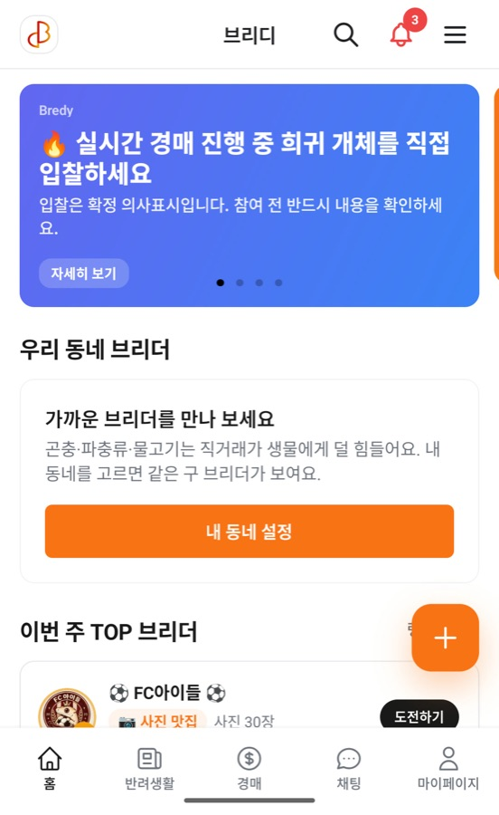
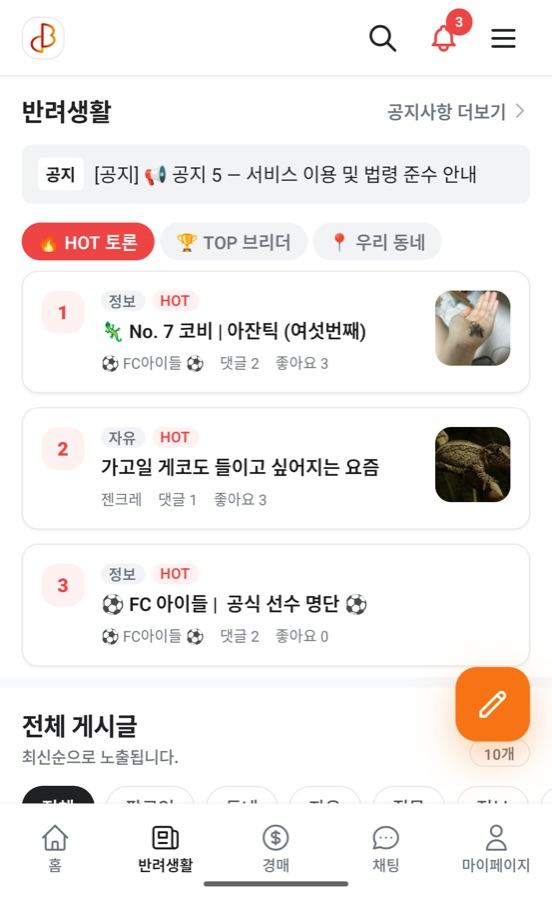
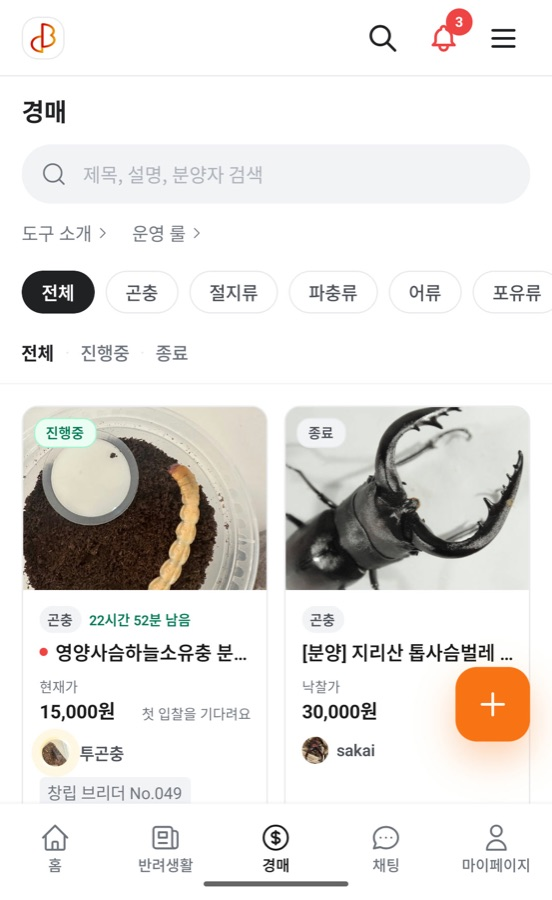

# 윤성준

프론트엔드 개발자입니다. 요즘은 AI 에이전트에게 일을 맡기는 방법을 가장 많이 고민합니다.

회사에서는 AI 계약 관리 서비스(앨리비)의 프론트엔드를 만들고,
퇴근 후에는 생물 커뮤니티 브리디를 혼자 만들고 운영합니다.

ytw418@naver.com · [원티드 이력서](https://social.wanted.co.kr//community/profile/8xuyY3Btrdg33yd7Fbbfkt?utm_source=wanted&utm_medium=share)

## 혼자서 팀처럼 일하는 방법

반복되는 일은 에이전트에게 맡겼습니다. 지금은 매일 19개 일정이 알아서 돌아갑니다.

- 인스타그램, 스레드, 페이스북, 틱톡, 유튜브, X 게시 자동화
- 웹 CI/CD, 앱 코드푸시, 앱스토어·플레이스토어 제출까지 명령 하나로 처리
- PostHog로 매일 지표를 보고, 문제를 찾고, 고치고, 다음 날 다시 확인
- SEO와 AEO(AI 검색 노출)까지 직접 작업
- 그 결과 출시 7일 동안 트래픽이 매일 두 배씩 늘었습니다

만든 스킬은 [ytw418-agent-skills](https://github.com/ytw418/ytw418-agent-skills)에 모아 두었습니다.

## 회사에서

AI 법률 에이전트와 계약서 검토·전자서명을 제공하는 SaaS입니다. (2025.06 ~)

- 신규 AI 계약 앱 Cue의 목록·상세·전자서명 FE 리드, PR 352건 머지
- 킥오프 대시보드: 기획서와 피그마를 모아 빠진 요구사항을 찾고 담당자별 질문지를 만듭니다. 기획자와 주고받는 확인이 크게 줄었습니다
- Jira 스킬: 티켓·브랜치·PR을 같은 형식으로 남겨 진행 상황을 따로 묻지 않아도 되게 했습니다
- i18n 950개 키 마이그레이션, 디자인 토큰, PostHog 퍼널·광고 전환 계측

## 브리디

[bredy.app](https://bredy.app/) · [인스타그램](https://www.instagram.com/bredy_breeder/) · [블로그](https://blog.naver.com/bredy_team) · [웹 레포](https://github.com/ytw418/breeder_web)

곤충, 파충류, 물고기를 키우는 사람들이 기록하고 분양하고 경매하는 서비스입니다.
기획, 디자인, 웹, 서버, 앱, 마케팅까지 혼자 맡고 있고, 세 번 다시 만들었습니다.

<table>
  <tr>
    <td></td>
    <td></td>
    <td></td>
  </tr>
</table>

Next.js · Prisma · PostgreSQL / Expo · React Native / PostHog · Sentry · Playwright

## 이전 경력

- 핀포인트 (2023~2025): 빌딩 관리 CMS. CS 데이터를 LLM으로 분석하는 기능을 만들었습니다
- 센슈얼모먼트 (2022~2023): 오디오·웹소설 플랫폼. Next.js 버그를 찾아 이슈로 올렸고, 다음 버전에서 수정됐습니다 ([#49844](https://github.com/vercel/next.js/issues/49844))
- 올맵 (2021): 웹, 하이브리드 앱

## TMI

- 에어팟이 없어도 집중을 잘합니다. 있으면 조금 더 잘합니다
- 엔비디아 주주입니다. 그런데 반도체는 없는 청년입니다
- 같은 일을 두 번 하면 자동화합니다
